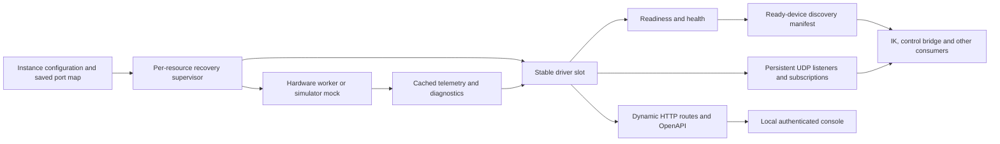

# HALo architecture and repository context

This audit covers the former `rove_sensor_api`, its drivers, wire protocols,
configuration, background workers, logging, documentation, simulator and consumers.
HALo preserves its central idea: hardware workers cache state, driver descriptors
provide one machine-readable contract, and consumers discover capabilities and
transport bindings at runtime. Motion planning, robot intent and reflex policy
remain outside the hardware layer.

## Stack boundaries

| Component | Responsibilities and HALo dependencies |
| --- | --- |
| HALo | Hardware connections, cached telemetry, driver commands, schemas, discovery, health, configuration and recovery |
| Rust `rove_control_bridge` | Missions, autonomous tracks, perception and reflexes; fetches discovery and subscribes to advertised UDP ports; legacy perception input also accepts LVXR streams |
| Python `rove_ik_engine` | URDF import, kinematics, collision checks, live mirroring, teleop and saved poses; binds through discovery |
| `rove_sim` | Profile-driven physics, hardware-format telemetry and robot intent adapters; can feed HALo mocks on separate backend ports |
| `robot_doc` | Canonical standard/caged models and meshes; a legacy IK model is retained separately |

The Python control bridge and external arm reachability watchdog were removed.
The native Livox bridge became a HALo driver. The driver library uses
`halo_livox_start/stop` for its private native ABI. One typed TOML configuration
generates the temporary vendor SDK JSON; hardware-instance JSON is not part of the
operator configuration. LiDAR samples use
the same HALo UDP subscription protocol as other drivers. Optional binary LVXR
mirrors remain available for older consumers in the driver configuration.

URDF model paths in simulator profiles and IK configuration now resolve to
`robot_doc`. Internal relative mesh references travel with their URDFs; previously
absolute Robotiq references were repaired. IK mesh delivery uses imported asset
bytes before falling back to older paths, so moving models does not break
browser visualization. Generated simulator URDF caches are ignored and rebuilt.

## Original implementation and failure causes

The old registry assigned `base + 2 * registry.len()` after each successful
connection. Missing early devices shifted later ports; ODrive's HashMap discovery
order added nondeterminism. Configuration could pin simulator ports but main
registration ignored served overrides. There was no persistent identity map.

HTTP/UDP handlers captured the original driver `Arc`, and OpenAPI was generated
once. Replacing entries in the registry alone would leave clients attached to
the old hardware. Startup performed blocking probes before listening on HTTP;
failed or unconfigured devices were skipped, leaving no operator recovery path.

Kinova's SDK initialization and Robotiq's Modbus attachment established a
controller connection before usable physical telemetry. Kinova accepted finite
subnormal SDK sentinel values as positions; Robotiq cached `link_up=true` even
when subsequent polling failed. Both could be advertised before actuators were
ready. A successful command queue write was often mistaken for hardware success.

Background task ownership also mattered. Dropping a CancellationToken does not
cancel its task. VectorNav, mock feeds and CAN workers needed explicit ownership
and joined teardown. A second UDP bind failure could orphan the first listener;
subscription interval zero could panic a task. These were repaired alongside the
supervisor so targeted retry has a dependable resource lifetime.

## Current data path

`SensorDriver` supplies identity, display name, telemetry descriptors, command
descriptors and command mode. Optional capabilities add estop, config,
calibration, persistence and endpoint writes. Common JSON command validation
rejects malformed scalar types, unknown fields and invalid numeric values.
Drivers also interpret their own sample timestamp, connectivity and error fields
through `telemetry_status`; the supervisor never recognizes hardware field names.
Device-specific implementations validate compound operations such as a complete
six-joint position/velocity setpoint.

`SensorRegistry` reserves ports separately from attachment and keeps a stable
`DriverSlot` for each known device. HTTP resolves the slot at request time; UDP
captures the stable slot, not a physical session. Recovery detaches the session,
awaits driver shutdown and replaces it behind that slot. Metadata/contracts must
match across replacements; capability/schema changes require a full restart.

`/discover` lists currently ready devices using its existing response shape.
Initial connection is insufficient: telemetry must advance, be fresh and pass
readiness/error checks. A previously ready device with fresh diagnostic errors
is degraded and remains discoverable for inspection. Stale or explicitly detached
devices leave discovery. Offline schemas remain in OpenAPI after a slot has been
created. Discovery is the dynamic binding manifest, not just documentation.

`/health` exposes driver groups; `/<id>/health` distinguishes controller connection,
hardware readiness, telemetry freshness and errors. Management state additionally
retains offline reservations, current attempt count/policy and historical error
state. History cannot establish current readiness.

The supervisor runs initialization deadlines, readiness monitoring and bounded
retry independently per resource group. It stops at the configured attempt count,
allows manual retry, and resets the budget after ten healthy seconds. A timeout
in a non-cancellable native SDK operation is quarantined until cleanup can run;
restarting a second initialization on top of it would risk port/resource conflicts.
Other groups continue throughout that wait.

## Driver audit and resource ownership

| Driver | Telemetry/connection behavior | Readiness and recovery |
| --- | --- | --- |
| VectorNav VN-300 | Serial read worker parses binary frames and ASCII fallback; sends startup binary-output configuration. Serial writes and cached state are shared with the driver. | A changing sample timestamp is required. Saved identity survives serial-path edits. Shutdown cancels and joins the read worker; dropping the session releases writer/read halves. |
| Kinova Gen2 | USB/Ethernet libraries dynamically load; discovery/init handshake precedes attachment. One OS thread serializes all SDK calls, cached polling and queued trajectory commands. | Valid non-sentinel joint reads, supply voltage and connected actuator count establish readiness; SDK/hardware errors are exposed. Shutdown rejects new work, cancels queued motion, restores normal control if limp, and joins the worker before another SDK session starts. |
| Robotiq 2F-140 | Serial Modbus worker owns its context, polls status registers and merges partial setpoints. Activation may precede usable jaw hardware. | Fresh successful polls plus gACT=1/gSTA=3 are required. Poll failures clear link state and record errors; incomplete activation is unavailable. Recovery stops the worker and releases serial context. |
| ODrive | One shared SocketCAN receive bus, per-node telemetry plus init/watchdog workers, shared endpoint map for arbitrary SDO/config operations. | Heartbeats/sample freshness and error bitmasks feed health. First discovery is sorted; IDs/ports persist. Recovery stops node workers before releasing the bus and rescans all nodes sharing it. Endpoint uploads survive the reconnect. |
| Livox Mid-360 | SDK2 native shared library routes callbacks into per-lidar Rust caches; per-lidar source updates feed the generic multi-subscriber DATA transport; optional legacy LVXR mirrors keep existing perception/calibration clients compatible. | Point and IMU freshness are independent. A configured but silent lidar is unavailable. All lidars share a single SDK session; its final drop stops native callbacks before releasing Rust context/library memory. |
| Simulator mocks | Backend UDP feeds reuse real driver schemas, including both lidars through the native adapter’s LVXR ingest/update path. Shared aggregate control publisher prevents one mock overwriting another's robot intent. | Mocks use the same supervisor and freshness checks. Retry cancels/joins feed tasks, preserves served sockets and maintains ODrive controller faults across transport recovery. |

Kinova position/velocity command acknowledgements still distinguish queueing from
physical completion. The worker coalesces incoming velocity commands, resends at
its configured cadence and stops a velocity hold after 300 ms without input.
Telemetry is polled at 10 Hz idle / 5 Hz streaming on the same SDK thread.
This prevents non-reentrant SDK calls from aliasing the shared UDP connection;
native call latency can still limit the actual cadence.

Limp mode is an explicit boolean command sent alone. Optional SDK torque symbols
are loaded for both transports with the vendor's enum/70-float ABI. The same worker
clears old trajectories, suppresses gravity vector compensation, verifies torque
mode and refreshes zero commands. Normal motion/keepalive is suppressed until an
explicit successful restore. Vendor protection parameters remain intact. Mode
feedback and a latched interlock expose failures; failed restore does not authorize
new motion. Reconnect restores configured gravity and normal control.
Physical release behavior is unvalidated in this environment; zero commanded
torque does not remove friction, damping or firmware protection. SDK mode feedback
is confirmation of the reported mode, not a torque sensor measurement.

In simulation, a separate optional `arm_limp_mode` control field releases the arm
motors. Mode telemetry confirms the simulator applied it. Leaving limp captures
the settled joint pose instead of replaying the old IK target. Bullet retains the
last motor-impulse reading after its servo is disabled; telemetry reports zero
actuator effort while the mock explicitly applies zero force. The existing joint
position/velocity mock command path remains a stub; limp has a real physics sink.

## Protocols, commissioning and deployment

Sensor JSON UDP packets retain a four-byte version/type/sequence header. Data
subscription and command ports remain separate; streaming is a consumer cadence
hint. Existing consumers bind from discovery. The Rust control bridge now waits
for its configured track nodes and VectorNav, since HTTP listening precedes hardware
initialization. IK retains its existing rediscovery/healing path; software that
needs devices added later must refresh discovery rather than cache it forever.

Instance port maps reserve missing devices as well as online ones. TOML served
pins seed only new identities; JSON persists console edits. Intentional port edits
stop/join listeners, validate/bind replacements and persist atomically, rolling
back on failure. Existing subscribers must subscribe to intentionally changed ports;
a hardware-only retry preserves their subscriptions.

Management uses a locally provisioned Argon2id hash and in-memory sessions. Static
assets are embedded, and runtime docs use discovery/OpenAPI rather than external
packages. Browser mutations require a custom request header. Legacy machine
HTTP/UDP routes remain on the trusted robot network to preserve consumers.
Production management requires TLS via a proxy and the Secure cookie option.
This compatibility boundary should be addressed explicitly if future authenticated
machine transport is introduced.

The systemd installer renders account/checkout/log paths and retains full-bounce
restart-on-failure. CAN setup belongs to host networking. Deployment must retire
previous service/watchdog processes and stop standalone Livox before SDK2 takeover.
Local overrides referencing the old URDF/API paths must migrate with the checkout.

## Validation scope

Rust tests cover decoding, controller-versus-hardware readiness, bounded retries,
persistent reservations, dynamic schemas, UDP continuity and failed port-bind
rollback. Limp state-machine tests cover explicit SDK sequencing, mode rejection,
failed restoration and firmware fallback. Native Livox fixtures cover ABI routing,
stream forwarding, startup failure, freshness and shared-session lifetime.

The real headless simulator plus Chromium test verifies the complete service and
console: absent telemetry, salted password hash permissions, login/throttling,
protected writes, thirteen ready devices including both lidars, targeted recovery, UDP continuity, limp
settling, latched faults, port edits, full bounce, historical state, schemas, logs,
offline asset requests and mobile layout. Model/import tests check relocated URDFs
and mesh resolution; consumer checks cover Rust bridge and simulator/IK linkage.

These checks establish the software paths. Physical serial reconnects, CAN bus
fault injection, the custom Kinova's torque/gravity behavior and SDK shutdown
latency still require validation on the robot. HALo is not claimed to be a
certified safety controller or a substitute for hardware estop circuitry.

## Extending HALo

Physical composition is declared in `src/drivers/loader.rs`. Core registry,
subscription, command validation and console code do not identify hardware brands.
A new driver implements `SensorDriver`, supplies data/command field descriptors and
registers its connection factory with the supervisor. Each configuration implements `DriverConfig` for validation, relative path
resolution and internal UDP reservations. One `configure::<T>` hook registers
connection editing using those same rules. Driver-owned HTTP extensions preserve
vendor compatibility routes without changing the generic HTTP layer.
The console consumes that capability instead of maintaining its own hardware list.

Follow [driver-template.md](driver-template.md) for the complete extension contract.

A driver can provide source updates by declaring `DataDelivery::Updates` and
returning a broadcast receiver from `subscribe_updates`. Stable registry slots
relay those events across reconnects; the generic UDP listener handles subscribers,
acknowledgements, sequence numbers, slow consumers and cancellation. Snapshot
subscriptions and all pre-existing packet types remain available. Command metadata
expresses readiness requirements and standalone fields inside the driver; the core
uses those declarations rather than recognizing command names.
